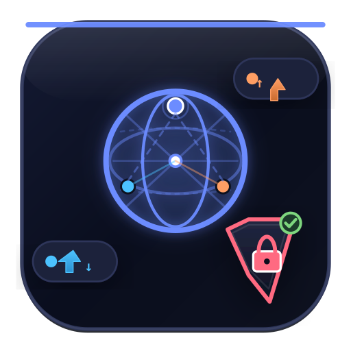
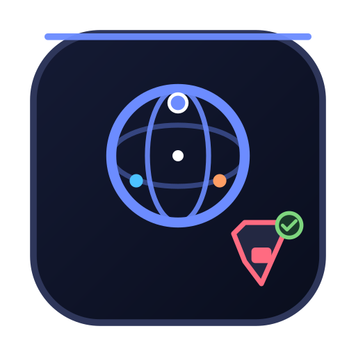
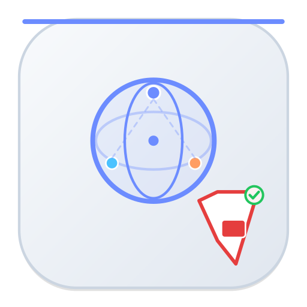
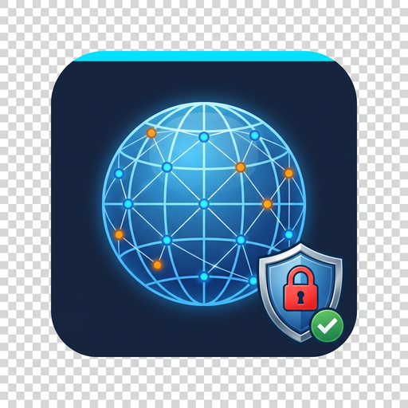

# Win-NetMon Icon 設計說明

> 檔案位置：`assets/icon.svg`（主檔，512px viewBox 192）、`assets/icon-simple.svg`（16–32px 精簡）、`assets/icon-light.svg`（淺底反白）、`assets/icon.png` + 多尺寸 PNG/ICO

## 設計語彙
- **圓角方塊（Squircle）**：`rx 36`、深空藍黑漸層 `#141a33 → #0a0e1e → #0d111f`，呼應 `theme.HEADER`，頂部 3px `#6c8cff` 品牌線與 `theme.ACCENT` 一致。
- **中央地球經緯**：外圈 38px + 內兩組橢圓經緯 + 斜線，`stroke #6c8cff 3px`，象徵「全域網路」與層級 1–2 的連線清單。
- **節點連線**：頂部脈動點（`#6c8cff` + 白邊）、左右 `DOWN #4cc2ff` / `UP #ff9e64` 節點，虛線連接成 Mesh，呼應「程式流量歸屬」與即時速率膠囊。
- **速率膠囊**：左下 `↓` 藍、右上 `↑` 橘，`#1e243b` 底 + `#2e365a` 邊框，與 App Header 的速率 pill 同款。
- **盾牌鎖（層級 5）**：右下 30px 盾牌 `fill #232842 → #0a0e1e`、`stroke #ff6b81 2.2px`，中心鎖身 + 綠色勾勾 `·1a3a2a/#7ed67e`，象徵防火牆封鎖與可信管制。
- **光暈與陰影**：`radial #6c8cff 22%→6%` 地球光暈、`feDropShadow 6/10 45%` 柔和陰影，確保在深色桌面/工作列上懸浮。

## 尺寸策略
| 檔案 | 用途 |
|------|------|
| `icon.svg` | 512 主檔，無限縮放，文件/官網 |
| `icon-simple.svg` | 64×64 精簡，無膠囊文字，16–32px 任務欄 |
| `icon-light.svg` | 淺色底反白，文件白底展示 |
| `icon.png` (512) | Tkinter `iconphoto` 載入，`app.py:_set_app_icon()` 自動尋找 |
| `icon-256/128/64/32.png` | 多解析度備援 |
| `icon.ico` (16,32,48,64,128,256) | Windows exe / 工作列，`build_exe.bat` 已自動 `--icon assets/icon.ico` |

## 顏色對照（與 `theme.py` 同源）
`BG #0d111f` / `HEADER #0a0e1e` / `ACCENT #6c8cff` / `DOWN #4cc2ff` / `UP #ff9e64` / `GREEN #7ed67e` / `RED #ff6b81` / `BORDER #2e365a`

## 在程式中使用
`MainApp.__init__` 呼叫 `_set_app_icon()`：
```python
candidates = [Path(__file__).parents[2]/"assets/icon.png", ...]
img = tk.PhotoImage(file=str(icon_path))
self.iconphoto(True, img)
self.iconbitmap("assets/icon.ico")  # Windows 工作列
```

## 預覽
| 主圖（深底） | 精簡 | 淺底 | PNG 512 |
|---|---|---|---|
|  |  |  |  |

> 建議：小尺寸（16px）自動切換 `icon-simple.svg`，避免盾牌細節糊掉。
